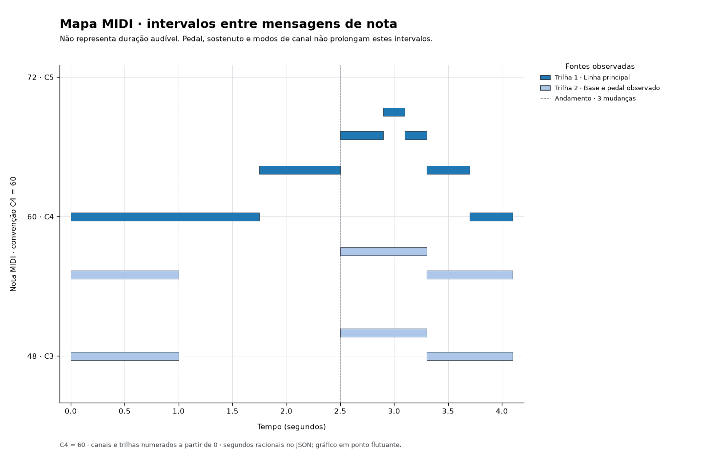

# Mapa MIDI

**Veja notas, eventos e mudanças de andamento de um arquivo MIDI, sem tocar áudio.**

Ferramenta local da [LOFRANO TECNOLOGIA](https://lofranotecnologia.com.br/) para conferir arranjos, localizar notas sem encerramento e exportar fatos com a origem de cada evento. Produz JSON, tabelas CSV, relatório Markdown e rolo de piano SVG/PNG.

[Baixar a versão 1.0.0](https://github.com/martinlofranodeoliveira/mapa-midi/releases/tag/v1.0.0) · [Como a leitura foi conferida](docs/INTEROPERABILIDADE.md) · [Contrato técnico](CONTRACT.md)



## Começar

Requer **Python 3.11 ou superior**. Não precisa de sintetizador, interface MIDI ou servidor. A instalação baixa as dependências; a inspeção trabalha com arquivos locais.

```bash
git clone https://github.com/martinlofranodeoliveira/mapa-midi.git
cd mapa-midi
python -m venv .venv
```

Ative o ambiente:

```bash
# Linux / macOS
source .venv/bin/activate

# Windows PowerShell
.venv\Scripts\Activate.ps1
```

```bash
python -m pip install .
mapa-midi exemplo --saida demo.zip
mapa-midi inspecionar arranjo.mid --saida relatorio.zip
```

Cada destino precisa ser **um arquivo novo**, dentro de uma pasta existente. Um arquivo ou link já presente nunca é substituído. O MIDI de entrada não é regravado.

O ZIP de exemplo inclui um MIDI sintético original e todos os relatórios. Não é uma gravação ou transcrição de música de terceiros.

## O que aparece no relatório

- Eventos de cada trilha, com índice, tick absoluto, porta, canal e campos decodificados.
- Mapa de andamento com tempo inicial padrão identificado e proveniência das mudanças.
- Intervalos entre note-on e note-off, incluindo note-on com velocidade zero.
- Notas abertas, desligamentos sem início, sobreposições da mesma nota e canais compartilhados entre trilhas.
- Programas e controladores observados, sem presumir instrumento General MIDI.
- SHA-256 dos bytes capturados e manifesto dos arquivos exportados.

Os tempos usam frações exatas. No exemplo, a nota 60 da trilha 1 atravessa uma mudança de andamento: seu intervalo vai do tick 0 ao 1440 e dura **7/4 s**, apresentado também como `1.750000000 s`.

## Escolher a saída

```bash
# JSON completo, com numerador e denominador de cada tempo
mapa-midi inspecionar arranjo.mid --saida fatos.json --formato json

# Duas tabelas e manifesto dentro de um ZIP
mapa-midi inspecionar arranjo.mid --saida tabelas.zip --formato csv

# Relatório textual com todos os eventos
mapa-midi inspecionar arranjo.mid --saida leitura.md --formato markdown

# Metadados codificados em UTF-8, com validação estrita
mapa-midi inspecionar arranjo.mid --charset utf-8 --saida utf8.zip
```

| Formato | Conteúdo |
| --- | --- |
| `bundle` — padrão | `resumo.json`, `eventos.csv`, `notas.csv`, `resumo.md`, `rolo.svg`, `rolo.png`, `manifesto.json` |
| `json` | Um relatório JSON |
| `csv` | ZIP com `eventos.csv`, `notas.csv` e `manifesto.json` |
| `markdown` | Um relatório Markdown |

O manifesto registra tamanho e SHA-256 de cada membro, exceto dele próprio. Ele detecta diferenças em relação ao registro; não é uma assinatura de autoria. A captura original só é incluída no comando `exemplo`.

CSV usa UTF-8 com BOM, CRLF e campos entre aspas. Textos que possam iniciar fórmulas recebem um apóstrofo de apresentação; o JSON mantém o texto original. Markdown escapa metadados. SysEx, dados específicos de sequenciador e metaeventos desconhecidos apresentam tamanho e digest, sem o payload opaco.

Código de saída `0`: relatório completo, mesmo com diagnósticos. Código `2`: erro de entrada, limite ou publicação. `130`: interrupção. O terminal mostra somente contagens ou erros sanitizados.

## Como interpretar

**Intervalo de mensagens não é duração audível.** Pedal de sustentação, sostenuto e modos de canal ficam nos eventos e nas contagens; não estendem nem encerram os intervalos calculados. Notas abertas têm apenas um início observado, sem fim inventado no gráfico.

O pareamento é FIFO por `(trilha, porta, canal, nota)`. Sobreposições recebem indicação de ambiguidade. Não há pareamento entre trilhas; a ordenação de eventos simultâneos não demonstra a intenção musical. Porta não declarada é distinta da porta explícita zero.

Trilhas, canais e índices começam em **zero**. O nome de altura adota **C4 = nota 60**. Números de programa são fatos, sem nomes de instrumentos presumidos. Assinaturas de compasso são registradas, sem reconstrução de compassos.

O charset padrão é `latin1`: cada byte textual tem um mapeamento reversível, sem tentativa de adivinhar a codificação. Use `--charset utf-8` quando souber que o arquivo contém UTF-8. O gráfico abrevia rótulos; o JSON conserva os metadados completos.

## Arquivos aceitos e limites

SMF tipos **0 e 1**, com PPQN positivo. Tipo 0 exige uma trilha. Tipo 2, divisão SMPTE/zero, andamento zero e andamento fora da trilha condutora no tipo 1 recebem erro explícito. O leitor combina um guard de framing limitado com **Mido 1.3.3**, comparando eventos e ticks dos mesmos bytes. Não é um validador SMF completo nem um conversor sem perdas. Mensagens SysEx aceitas seguem o subconjunto que o decoder consegue representar; um escape arbitrário pode ser recusado.

Metatipos conhecidos são representados pelos campos decodificados pelo Mido; bytes de extensão após esses campos podem ser ignorados conforme SMF. Metadados sem o prefixo de bytes necessário aos campos desse perfil são recusados, sem preencher valores ausentes. O SHA identifica a captura inteira; o relatório não reproduz todos os bytes.

| Recurso | Limite padrão |
| --- | ---: |
| Arquivo | 8 MiB |
| Trilhas | 128 |
| Eventos | 200.000 |
| Payload por evento | 256 KiB |
| Note-ons positivos | 100.000 |
| Diagnósticos | 100.000 |
| Notas no gráfico | 20.000 |
| Trilhas com notas no gráfico | 32 |
| Membros descompactados / saída | 64 MiB |

Exceder um limite recusa a operação inteira. Se apenas o gráfico exceder seu limite, solicite JSON, CSV ou Markdown. A API Python permite configurar `Limits`; a CLI usa os valores padrão. A saída é preparada por completo e publicada com link exclusivo de um temporário irmão; sistemas de arquivos sem esse recurso recebem erro, sem substituição como fallback.

## Usar em Python

```python
from mapa_midi import read_path
from mapa_midi.analysis import analyze

captura = read_path("arranjo.mid", charset="latin1")
relatorio = analyze(captura)
for nota in relatorio["notes"]:
    print(nota["note_name"], nota["duration_seconds"])
```

`read_bytes` permite inspecionar bytes já capturados. Os modelos são imutáveis; a análise valida a estrutura recebida. O SHA identifica os bytes lidos, sem prometer que o caminho continuará contendo esses bytes depois da captura.

## Desenvolver e conferir

```bash
python -m pip install -e . build==1.3.0
python -m unittest discover -s tests -v
python -m build
python scripts/check_release.py
python scripts/check_installed.py --wheel dist/mapa_midi-1.0.0-py3-none-any.whl
```

Os testes cobrem relógio racional, pareamento, limites, framing, relatórios, publicação sem sobrescrita e geometria do gráfico. A verificação independente executa **csvmidi e midicsv em C** sobre dados originais, comparando fatos e oráculos manuais; ela não transforma um roundtrip em prova de toda a semântica. Consulte os comandos e as evidências em [INTEROPERABILIDADE.md](docs/INTEROPERABILIDADE.md) e o escopo da distribuição em [VALIDACAO.md](docs/VALIDACAO.md).

Contribuições úteis incluem arquivos sintéticos mínimos que reproduzam um problema, o resultado esperado e um teste. Não envie músicas ou arquivos de terceiros sem permissão. Consulte [CONTRIBUTING.md](CONTRIBUTING.md).

## Licença

Código e exemplos originais sob [MIT](LICENSE). Mido, Matplotlib e o consumidor externo mantêm suas licenças próprias; veja [THIRD_PARTY_NOTICES.md](THIRD_PARTY_NOTICES.md).
